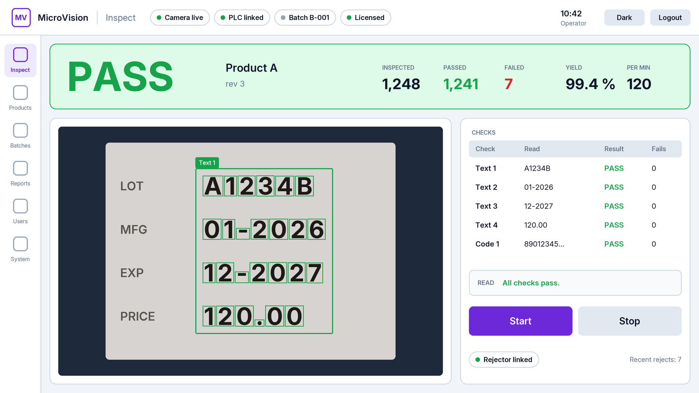
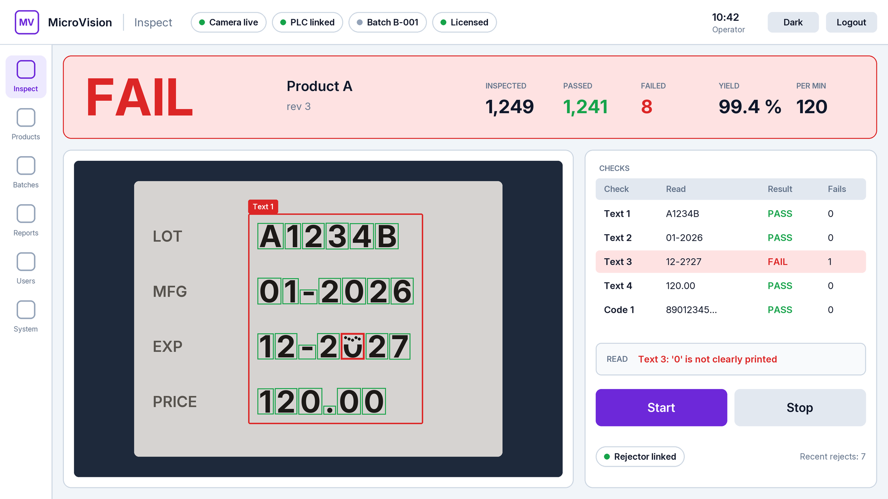
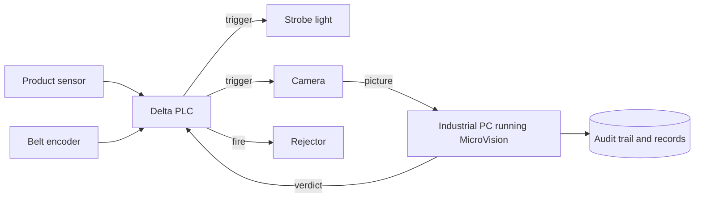
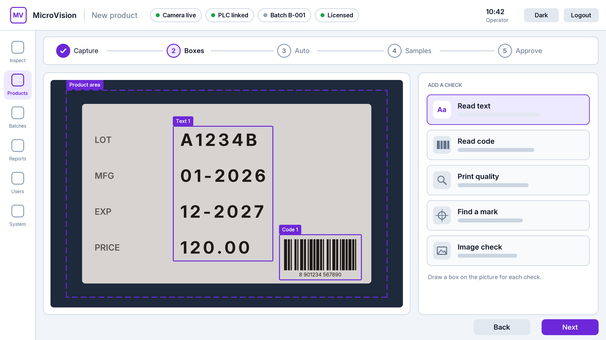
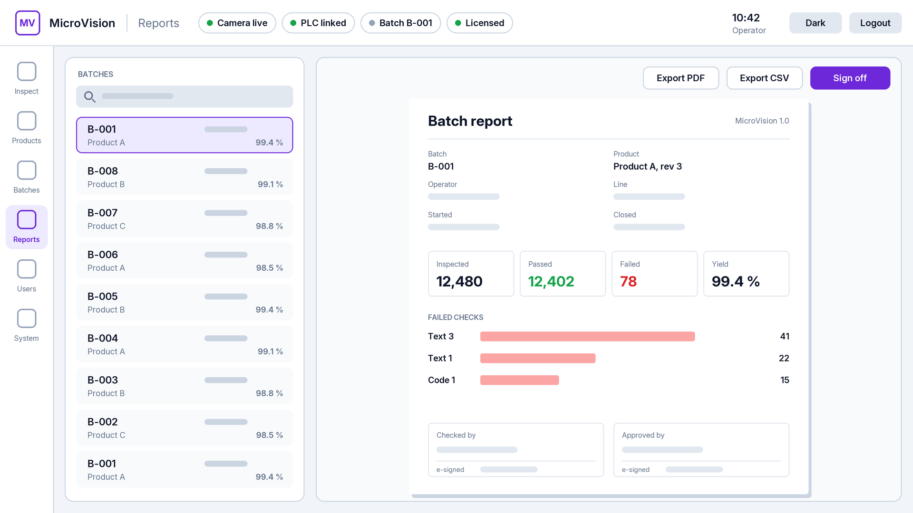

# MicroVision: automated print inspection for pharmaceutical packaging

MicroVision is a camera system that reads the batch number, dates and price printed on every pack, checks them against the running batch and rejects the packs that are wrong. It runs on an industrial PC with no GPU.

It has been in production on a client's pharmaceutical labelling line since September 2026. I built it as the sole developer at Microtech Systems. The source code is proprietary and is not included here.

## Demo

The images below are wireframe drawings of the operator screens. They are not screenshots, and every printed value in them is made up.

<picture>
  <source media="(prefers-color-scheme: dark)" srcset="assets/inspect-pass-dark.png">
  
</picture>

<picture>
  <source media="(prefers-color-scheme: dark)" srcset="assets/inspect-fail-dark.png">
  
</picture>

## The problem

Pharmaceutical packs in India carry a batch number, manufacturing and expiry dates, and the maximum retail price (MRP). A single wrong or smeared digit breaks the labelling rules, so every pack has to be checked.

Everything, neural networks included, had to run on the CPU. Labelled data was scarce, so a new product had to be taught from about ten pictures. The line is regulated, so every verdict, change and approval must be traceable. And the verdict has to reach the rejector before the pack does.

## My role

- Designed the rejection system's electrical panel.
- Programmed the Delta DVP PLC that tracks each pack to the rejector, across several revisions of its ladder logic.
- Wrote the link between the PC and the PLC, using Modbus over RS-485.
- Wrote the vision software in C++23, covering the inspection engine, the operator interface, records, reports and the installer.
- Trained the neural networks that read and check characters.
- Commissioned the machine on the client's line.

## Architecture

The product sensor tells the PLC that a pack has arrived. The PLC fires the strobe and the camera, then moves the pack along a virtual conveyor in step with the encoder's pulses. When the pack reaches the rejector, the PLC applies the verdict the PC sent for that pack. Tracking follows the encoder, so a belt that slows down or stops cannot move a reject onto the wrong pack. If packs and verdicts ever stop matching, the line stops and the screen says why.

## Inspection pipeline

1. A pattern search finds the printed block on the pack, allowing for small shifts and tilt.
2. Each printed line is split into characters and matched against the product's taught font. A neural text reader can also read the line independently.
3. The text is compared with the batch number, dates and MRP expected for the running batch.
4. A small neural network checks every character again and rejects smeared or half-printed ones, even those that look right at a glance.
5. 1D barcodes, QR codes and DataMatrix codes are decoded and their content checked.
6. Any failed check rejects the pack, and so does any check that could not run.

## Operator workflow

Teaching a product takes about ten pictures of good packs, a box around each thing to check, and a press of Auto. A supervisor reviews the samples and approves the product with an electronic signature, which locks it. The operator opens a batch and presses Start, and any fault stops the line with a plain-language message. Batch reports, the audit trail and pictures of rejected packs export as PDF and CSV.

<picture>
  <source media="(prefers-color-scheme: dark)" srcset="assets/teach-dark.png">
  
</picture>

<picture>
  <source media="(prefers-color-scheme: dark)" srcset="assets/report-dark.png">
  
</picture>

## Results

| Measure | Result |
|---|---|
| Inspection time per pack (median, development PC) | 116 ms down to 41 ms |
| Regression check for that change | 0 verdict changes across 4,253 client images |
| Neural text reader | about 3 ms per printed line |
| Character checker | 170k parameters, about 3 ms per pack |
| Rejects on a 2,254-part production batch | 238 down to 40, with 0 good parts newly failing |
| Deliberately misprinted test images | 180 of 180 rejected |
| Automated tests | 1,518 passing |
| Hardware | CPU only, no GPU |

Most of the 238 original rejects were good packs flagged for stray specks and loose dots of ink.

## Designed for 21 CFR Part 11

MicroVision is designed to support 21 CFR Part 11 compliance. Formal IQ/OQ/PQ validation is in progress.

- Access is role based. Users belong to groups, and every action needs a named right.
- Electronic signatures guard actions such as releasing a product or closing a batch. The signer enters the password again, and the system records what was signed.
- The audit trail is hash chained. Each record stores a SHA-256 hash of its content and the previous record's hash, so changing or deleting a past record breaks the chain from that point, and the built-in check reports it.
- Approved products are never overwritten. A change creates a new revision, and the old revisions stay on record.

## Engineering decisions and lessons

- The line PCs have no GPU, so every network is small and runs through OpenCV's DNN module. A model ships only when PyTorch, ONNX Runtime and OpenCV give the same answers. A shared network instance raced under parallel inspection, so each thread now has its own.
- Profiling showed that finding the print took longer than reading it, because the search re-checked positions and angles at full resolution. Pruning weak candidates and checking fewer angles at reduced size cut the median from 116 ms to 41 ms. It shipped only after 4,253 client images gave the same verdicts through old and new code.
- Saved line pictures can be re-run through the production verdict path. I used this to sort false rejects by cause: stray specks, loose dots in dot-matrix print and split dashes. A fix stayed only if no previously passing pack failed.
- Correcting where the text check reads also exposed false accepts: the old logic had passed a few packs with a one-digit misprint. The new logic rejects them.

## Tech stack

- Software: C++23, CMake, Ninja, GCC (MinGW-w64), raylib, Dear ImGui
- Vision: OpenCV with its DNN module, Tesseract OCR, ZXing-cpp, Hikrobot MVS SDK
- Records: SQLite, OpenSSL for SHA-256, libharu for PDF
- Machine links: Modbus over RS-485 to the PLC, and libmodbus for a Modbus TCP server
- Training: Python, PyTorch, ONNX, ONNX Runtime
- Hardware, PLC and packaging: KiCad, Delta DVP ladder logic, Inno Setup

## What's next

Version 2.0 was demonstrated to the client in October 2026. It adds the faster print search and a neural line reader as a second opinion, and its rollout follows. A second machine, for cartons, is being commissioned. Formal IQ/OQ/PQ validation is under way.

## Notice

MicroVision is a Microtech Systems product. Its source code, PLC programs and client data are proprietary and not included. All rights reserved.

---

**Nikunj Tank** — Computer Vision & Industrial Automation Engineer, Ahmedabad
[LinkedIn](https://linkedin.com/in/nikunjtank1) · ntank41@gmail.com
